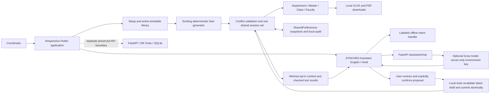

# SYNCHRO — Smart Campus Timetable System (JARVIS 3.0)

[](https://github.com/fkmshackathon/JARVIS-3.0-NEW-/releases/latest/download/SYNCHRO-Android.apk)
[](https://github.com/fkmshackathon/JARVIS-3.0-NEW-/actions)
[](https://flutter.dev)
[](https://fastapi.tiangolo.com)

---

## Buildasaur Round 2 — implemented in the existing app

- **Nature theme:** shared forest, leaf and mint tokens, original painted sprout,
  responsive full-width desktop workspace, bundled Noto Sans/Devanagari fonts.
- **Connected views:** Department (all matching batches), Master, Class and
  Faculty read the same active `ManualTimetableController.sessions`. Filters and
  edits never create independently generated copies.
- **Downloads:** actual `.xlsx` OOXML workbooks and printable landscape `.pdf`
  documents. Excel includes a chronological schedule, weekly/free-period grid,
  metadata, frozen header, filters and numeric time cells. Exports use the
  **current selected draft, including unsaved changes**, and all matching rows.
- **SYNCHRO Assistant:** English, Hindi (Devanagari) and automatic language
  matching. The floating entry opens suggestions, history, a language selector,
  loading/error feedback and explicit live/demo source labels. No chat can
  directly modify a timetable. Context sharing is minimal and resource details
  are opt-in. Chats are held in memory and cleared on sign-out.
- **Safe local operations:** absence/proxy, room closure, seminar reservation,
  extra lecture and teacher swap produce checked proposals. Subject
  authorisation (explicit or configured teaching-load mapping), availability,
  capacity, lab suitability, sharing, teaching windows, breaks and optional hard
  workload caps are checked. The user reviews before/after assignments and
  confirms; the app rejects stale data, revalidates, commits atomically and
  records a bounded local audit/undo trail. Unaffected classes are preserved.
- **Architecture:** open **Architecture** from Overview for a pannable diagram
  and a two-minute explanation of the real local, server and external boundaries.

### Honest prototype boundaries

The existing sign-in/sign-up flow is a **local demo session**, not production
authentication. There is no faculty messaging, remote approval workflow or
multi-user locking. Disruptions currently edit the **recurring weekly draft**;
date-specific exceptions, temporary date ranges and academic-calendar overrides
are not implemented. No mathematically optimal result is claimed. Room equipment
is configured inventory used for event room selection; per-subject equipment
constraints are not an existing generator input.

Groq was **not present in the inspected checkout**. The new server route is
implemented, but live AI requires a valid server-side environment credential.
Missing credentials/provider errors leave the app usable through clearly
labelled deterministic English/Hindi guidance. Offline guidance never pretends
to be a model response. Tests mock the provider and never call a paid AI API.

### Enable live Groq without exposing a key

Rotate any key that has been pasted into a chat. Do not put it in source code,
`--dart-define`, client settings, screenshots or logs. In the backend terminal,
load a fresh key using a hidden prompt or your deployment's secret manager:

```bash
# Bash (the value is not echoed or written to shell history)
read -rs -p "Groq API key: " GROQ_API_KEY; export GROQ_API_KEY
export GROQ_MODEL=llama-3.3-70b-versatile
```

```powershell
# PowerShell (process environment only)
$secure = Read-Host 'Groq API key' -AsSecureString
$env:GROQ_API_KEY = [System.Net.NetworkCredential]::new('', $secure).Password
$env:GROQ_MODEL = 'llama-3.3-70b-versatile'
```

Then run the existing FastAPI server below. `/assistant/config` reports only
configuration readiness, never the key. `/assistant/chat` bounds inputs,
allowlists/redacts context, limits requests and uses provider timeouts. Failed
provider requests return safe errors; the frontend visibly labels its offline
fallback. Before a public paid deployment, add real authentication and a
distributed gateway quota; the current per-IP limiter is process-local.

## 📱 Quick Android Installation

**Faculty First. Smart Timetable.**

Anyone with a compatible Android smartphone can download and install the newest official release build directly:

1. **Permanent direct download:** **[Download SYNCHRO for Android](https://github.com/fkmshackathon/JARVIS-3.0-NEW-/releases/latest/download/SYNCHRO-Android.apk)**
   This `releases/latest/download/SYNCHRO-Android.apk` URL is version-independent: every published release attaches the APK under exactly the same asset name, so this link always serves the newest build and never needs editing.
2. **Enable Unknown Apps / Sideloading (if prompted):**
   - When opening the downloaded APK, Android may ask for permission to install apps from your browser or file manager.
   - Tap **Settings** → toggle **Allow from this source** → return and tap **Install**.
3. **Compatibility:** Requires **Android 8.0 (Oreo / API Level 26) or newer**.
4. **Offline First:** The app operates completely standalone out of the box with zero required cloud setup.
5. **Updating an existing install:** New downloads always get the latest APK. A phone that already has SYNCHRO is **not** updated automatically — there is no in-app updater — so someone must install the new APK over it. From v1.1.0 onward every release shares one signing certificate, so installing over an older build works; a v1.0.0 install must be uninstalled first (see [Releasing a new APK](#-releasing-a-new-apk)).

---

## 🏛️ System Overview & Architecture

JARVIS 3.0 (SYNCHRO) is an automated smart-campus timetable management system built with Flutter and Python FastAPI. It automates class schedule generation, conflict detection, room utilization, and faculty workload management.



### Key Capabilities
- **Overview Dashboard:** Institutional summary, academic calendar rhythm, readiness metrics, and timetable library switcher.
- **Academic Setup:** Configure working days, mandatory break intervals, classrooms/laboratories, departments, faculty rosters, student batches, and teaching requirements.
- **Deterministic Solver & Timetable Grid:** Interactive day/week timetable matrix with live class inspection, conflict highlighting, and unassigned period accounting.
- **Timetable Library:** Manage multiple persistent academic schedules (duplicate, rename, delete, switch) stored locally via `shared_preferences`.
- **Issues & Audit:** Dedicated conflict detection reporting hard constraints (faculty clashes, room double-bookings, capacity violations) and soft balance warnings.
- **FastAPI / OR-Tools Backend (Preserved Boundary):** Industrial-grade CP-SAT constraint satisfaction engine for server-side solving, validation, and historical run inspection.

---

## ⚙️ Environment Configuration

Copy `.env.example` to configure local or deployment environments:

```bash
cp .env.example .env
```

| Variable | Description | Default | Target |
|---|---|---|---|
| `SYNCHRO_API` | Optional API override; never contains a secret | `http://localhost:8000` in web development; same origin for release web | Flutter build |
| `PORT` | Listening port for FastAPI server | `8000` | Backend |
| `HOST` | Binding address for FastAPI server | `0.0.0.0` | Backend |
| `SYNCHRO_DB` | SQLite database file location | `synchro.db` | Backend |
| `SYNCHRO_CORS_ORIGINS`| Allowed CORS origins (comma-separated or `*`) | `*` | Backend |
| `GROQ_API_KEY` | Provider credential, supplied through a secret manager / process environment | unset (offline fallback) | Server only |
| `GROQ_MODEL` | Groq model identifier | `llama-3.3-70b-versatile` | Server only |
| `SYNCHRO_WEB_DIR` | Optional static Flutter build served after API routes | set by Docker | Server only |

---

## 💻 Local Development Guide

### Prerequisites
- Flutter SDK `3.47.1`, pinned in `.fvmrc` (Dart `3.13.1`)
- Python `3.14.7`, pinned in `.python-version`
- Git

### 1. Backend Setup (FastAPI)
```bash
# Create and activate virtual environment
python -m venv .venv
# Linux / macOS:
source .venv/bin/activate
# Windows PowerShell:
.venv\Scripts\Activate.ps1

# Install dependencies
python -m pip install -r backend/requirements.txt

# Run the backend locally
uvicorn app.main:app --app-dir backend --reload --host 0.0.0.0 --port 8000
```
Verify the backend at:
- Health check: `http://localhost:8000/health`
- Interactive Swagger docs: `http://localhost:8000/docs`
- Sample campus payload: `http://localhost:8000/sample-campus`

### 2. Frontend Setup (Flutter)
```bash
# Get dependencies
flutter pub get --enforce-lockfile

# Run on Android device or emulator
flutter run

# Run on Chrome for web development
flutter run -d chrome --web-port 8080 --dart-define=SYNCHRO_API=http://localhost:8000
```

---

## 🧪 Testing and Quality Assurance

Run the comprehensive test suites across both the Flutter client and the Python solver backend:

```bash
# After initial dependency installation, all tests work without network/AI keys:
make test

# Static analysis
flutter analyze --no-pub

# Flutter unit, widget, responsive and generated-file tests
flutter test --no-pub

# Python tests (activate the project virtualenv first)
python -m pytest backend/tests
```

The export test creates sample files under `build/export-validation/`, decodes
the workbooks and verifies PDF signatures. `round2_widgets_test.dart` covers
375/390/430px, tablet and desktop layouts and the global assistant/architecture
entry points. Operations tests cover eligibility, busy/no-substitute cases,
room/lab closures, seminars, extra sessions, swaps, confirmation, stale-draft
rejection, isolation, persisted audit and guarded undo.

---

## 🚀 Backend Production Deployment Guide

The backend can be deployed in minutes on any container platform or cloud provider.

### Option A: Railway / Render (One-Click Docker)
1. Fork or push this repository to GitHub.
2. In **Render** or **Railway**, create a **New Web Service** connected to your repository.
3. Configure:
   - **Environment:** Docker
   - **Dockerfile Path:** `./Dockerfile`
    - **Port:** `8080` (or the platform-provided `PORT`)
   - **Healthcheck Path:** `/health`
4. Deploy the service. Your backend will be accessible at `https://your-app.onrender.com`.

### Option B: Docker CLI / VPS
```bash
# Build the production container image
docker build -t jarvis-synchro:latest .

# Run the container
docker run -d \
   -p 8080:8080 \
   --env GROQ_API_KEY \
   -e SYNCHRO_CORS_ORIGINS="http://localhost:8080" \
  --name jarvis-synchro \
  jarvis-synchro:latest
```

Open `http://localhost:8080`. The production image serves the Flutter web build
and API on one origin. Dependencies and fonts are bundled at build time;
provider credentials are injected only when starting the container. Use HTTPS
and a real identity/quota gateway for a public deployment.

---

## 📦 Building the Android Release APK Locally

Release signing reads `android/key.properties` (git-ignored) or the `STORE_FILE`,
`STORE_PASSWORD`, `KEY_ALIAS` and `KEY_PASSWORD` environment variables. Without
either, Gradle falls back to the Android **debug** key — fine for testing, never
a valid production release.

```bash
flutter clean
flutter pub get
flutter analyze
flutter build apk --release --dart-define=SYNCHRO_API=https://jarvis-synchro-backend.up.railway.app
```

The compiled APK lands at `build/app/outputs/flutter-apk/app-release.apk`.
Verify identity and version before distributing:

```bash
build-tools/apksigner verify --print-certs app-release.apk   # must show CN=SYNCHRO
build-tools/aapt2 dump badging app-release.apk | head -1      # versionName/versionCode
```

---

## 🔄 Automated CI/CD & GitHub Actions

`.github/workflows/release.yml` runs two ordinary jobs and one gated job:

1. **Backend tests** — `pytest backend` on Python 3.12.
2. **Flutter checks** — `flutter analyze` + `flutter test` on the pinned 3.47.1 SDK. These run on every push to `main` and every pull request.
3. **Build & publish** — runs **only** when a `v*` tag is pushed (or a manual run names a tag). It checks the tag against the `pubspec.yaml` version, builds the signed release APK against the HTTPS backend URL, refuses to publish a debug-signed APK, attaches `SYNCHRO-Android.apk` plus its SHA-256 to a GitHub Release, and never publishes on a plain code push.

### Releasing a new APK

1. Land the changes on `main`, then bump `version: X.Y.Z+N` in `pubspec.yaml` (`versionCode` must increase every release).
2. Push the tag: `git tag vX.Y.Z && git push origin vX.Y.Z`.
3. CI builds, signs, and publishes. The permanent link
   `…/releases/latest/download/SYNCHRO-Android.apk` then serves the new build
   automatically — keep the asset name exactly `SYNCHRO-Android.apk` and do not
   hardcode a version into the README link.

### One-time GitHub configuration (required before CI can sign)

Add these repository secrets under **Settings → Secrets and variables → Actions**:

| Secret | Value |
|---|---|
| `ANDROID_KEYSTORE_BASE64` | `base64 -w0 synchro-release.keystore` |
| `KEYSTORE_PASSWORD` | keystore password |
| `KEY_ALIAS` | `synchro` |
| `KEY_PASSWORD` | key password |
| `SYNCHRO_API_URL` | optional; defaults to `https://jarvis-synchro-backend.up.railway.app` |

The keystore itself must **never** be committed — `*.keystore`, `*.jks` and
`key.properties` are git-ignored. Back the keystore up off-machine: lose it and
no future APK can update installed SYNCHRO copies.

> **v1.0.0 signing note:** the first release was built by an older workflow that
> generated a throwaway keystore inside the CI runner, so that key no longer
> exists. v1.1.0 introduced the durable `CN=SYNCHRO` certificate. Anyone still
> on v1.0.0 must uninstall it before installing v1.1.0 or newer; from v1.1.0
> forward, installing over an older release works normally.
